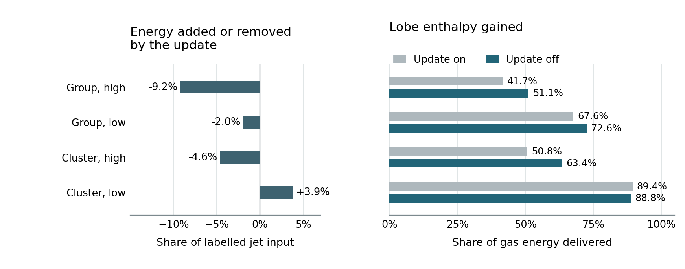

# Lobe enthalpy is 40–87% of reconstructed net jet supply at 30 Myr

Native-energy brief · Draft of 23 November 2026\
Barry W. Brook · Analysis and draft by Codex (OpenAI, GPT-6) · Review by Claude (Anthropic, Fable 5.2)\
This brief summarises the living [X-ray cavities project](https://github.com/BWBrook/xray_cavities).

{#fig-native-brief width=100%}

Jets from black holes inflate lobes in the hot gas around galaxies. How much of the energy supplied by a jet can we recover from a lobe's pressure and volume?

We measured the lobes directly in four simulations of high- and low-power jets in cluster and group atmospheres. Our *lobe* includes the full volume of every cell containing more than 0.1% jet material by mass. Its *enthalpy estimate* for non-relativistic gas is 2.5 times the sum of current pressure times volume in these cells. <!-- claims: NAT-05 NAT-01 -->

The injector emits gas through two cones. Its stationary surface also exchanges energy with surrounding gas. We added these signed flows, including pressure work, from startup to each saved age to reconstruct the net supply. <!-- claims: NAT-01 -->

1. **The power label understates the net gas supply.** By 30 Myr the net supply exceeds the labelled kinetic energy by 16% and 11% in the high- and low-power cluster runs (C-HI, C-LO) and by 16% and 15% in the corresponding group runs (G-HI, G-LO). <!-- claims: NAT-01 NAT-07 -->

2. **The fraction depends on which energy we count.** At selected ages from 10 to 50 Myr (through 40 Myr for G-HI), lobe enthalpy accounts for 45–48% of net supply in C-HI, 58–99% in C-LO, 40–43% in G-HI and 54–68% in G-LO. Counting only energy from the cones gives 54.5–95.6% in C-LO and 53.0–67.7% in G-LO. The high-power fractions change by less than 0.1 percentage point. Using 4pV raises each value by 60%. <!-- claims: NAT-01 -->

3. **The lobe edge matters.** At 50 Myr C-LO's enthalpy is 98.6%, 84.7% or 76.5% of net supply when cells must contain more than 0.1%, 0.5% or 1% jet material. Counting more mixed cells increases the volume. At all five ages the lobe's mean pressure is within 5% of the initial mean in the same cells at the primary cut. <!-- claims: NAT-01 NAT-05 -->

4. **We can measure the energy change around each lobe separately.** At 30 Myr lobe enthalpy is 43–81% of the change in thermal, motion and gravitational energy in spheres enclosing the lobes. The storage estimate depends on the gravitational reference. Energy crossing each sphere remains unmeasured, so the difference cannot tell us how much energy permanently heated the atmosphere. <!-- claims: NAT-07 -->

There is one production run per case. The saved outputs miss intermediate updates and a final speed dip. Over intervals ending at 20–47 Myr, the main method reproduces the balance of marked jet gas to within 0.04% of labelled mass per interval. A first-order reconstruction misses by 5.6–6.2%. <!-- claims: NAT-01 -->

\newpage

## How much does the solver change the lobe?

We repeated ages 10–12 Myr in all four jets. Turning the solver’s entropy update off raised lobe enthalpy gain per unit of gas energy delivered during those two Myr from **41.7% to 51.1% in G-HI** and **50.8% to 63.4% in C-HI**. At 12 Myr, higher pressure raised enthalpy by 3.6% and 4.3%, with less than 0.16% change in volume. Including the shared first 10 Myr gives smaller rises of 1.6 and 2.1 percentage points. The gap grew faster in the second Myr. Its size at 30 Myr is unknown. <!-- claims: BND-14 NAT-12 -->

{#fig-entropy-brief width=100%}

At low power the same update added 3.88% of labelled energy in the cluster and removed 1.96% in the group. Turning it off changed the enthalpy gain per unit delivered from 89.4% to 88.8% in C-LO and 67.6% to 72.6% in G-LO. Tightening the cluster lobe’s boundary reversed its small change. The overall energy error therefore gives no simple correction for a lobe at a later age. <!-- claims: BND-15 NAT-13 -->

The low-power experiment also tested a prediction made before the runs. The energy update fell inside its forecast range in both atmospheres in both million-year intervals. With the update off, the independent energy balances closed to within 0.03% of labelled input in each of the 38 intervals scored. <!-- claims: BND-15 -->

Claude independently checked 19 primary results, 228 method combinations and the high-power restart comparison from the archived injector rates and lobe measurements. A separate calculation verified the low-power budgets against the solver records. [Original calculations](https://github.com/BWBrook/xray_cavities/blob/main/docs/science/native_delivery_restatement_2026-11-21.md) · [High-power comparison](https://github.com/BWBrook/xray_cavities/blob/main/docs/science/entropy_restart_lobes_2026-11-23.md) · [Low-power scores and data](https://github.com/BWBrook/xray_cavities/blob/main/docs/science/low_power_entropy_result_2026-11-23.md).
