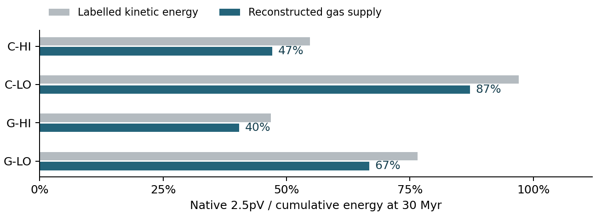

# Lobe enthalpy is 40–87% of reconstructed net jet supply at 30 Myr

Native-energy brief · Draft of 23 November 2026\
Barry W. Brook · Analysis and draft by Codex (OpenAI, GPT-6) · Review by Claude (Anthropic, Fable 5.2)\
This brief summarises the living [X-ray cavities project](https://github.com/BWBrook/xray_cavities).

{#fig-native-brief width=100%}

Jets from black holes inflate lobes in the hot gas around galaxies. How much of the energy supplied by a jet can we recover from a lobe's pressure and volume?

We measured the lobes directly in four simulations of high- and low-power jets in cluster and group atmospheres. Our *lobe* includes the full volume of every cell containing more than 0.1% jet material by mass. Its *enthalpy estimate* for non-relativistic gas is 2.5 times the sum of current pressure times volume in these cells. <!-- claims: NAT-05 NAT-01 -->

The injector emits gas through two cones. Its stationary surface also exchanges energy with surrounding gas. We added these signed flows, including pressure work, from startup to each saved age to reconstruct the net supply. <!-- claims: NAT-01 -->

1. **The power label understates the net gas supply.** By 30 Myr the net supply exceeds the labelled kinetic energy by 16% and 11% in the high- and low-power cluster runs (C-HI, C-LO) and by 16% and 15% in the corresponding group runs (G-HI, G-LO). <!-- claims: NAT-01 NAT-07 -->

2. **The fraction depends on which energy we count.** At selected ages from 10 to 50 Myr (through 40 Myr for G-HI), lobe enthalpy accounts for 45–48% of net supply in C-HI, 58–99% in C-LO, 40–43% in G-HI and 54–68% in G-LO. Counting only energy from the cones gives 54.5–95.6% in C-LO and 53.0–67.7% in G-LO. The high-power fractions change by less than 0.1 percentage point. Using 4pV raises each value by 60%. <!-- claims: NAT-01 -->

3. **The lobe edge matters.** At 50 Myr C-LO's enthalpy is 98.6%, 84.7% or 76.5% of net supply when cells must contain more than 0.1%, 0.5% or 1% jet material. Counting more mixed cells increases the volume. At all five ages the lobe's mean pressure is within 5% of the initial mean in the same cells at the primary cut. <!-- claims: NAT-01 NAT-05 -->

4. **We can measure the energy change around each lobe separately.** At 30 Myr lobe enthalpy is 43–81% of the change in thermal, motion and gravitational energy in spheres enclosing the lobes. The storage estimate depends on the gravitational reference. Energy crossing each sphere remains unmeasured, so the difference cannot tell us how much energy permanently heated the atmosphere. <!-- claims: NAT-07 -->

There is one production run per case. We repeated ages 10–12 Myr for each high-power jet with the solver's entropy update turned off. At 12 Myr the lobe volume changed by less than 0.16%. Higher mean pressure raised its enthalpy by 3.6% in the group and 4.3% in the cluster. The enthalpy fractions rose by 1.6 and 2.1 percentage points. The size of this effect at 30 Myr is still unknown. The saved outputs miss intermediate updates and a final speed dip. Over intervals ending at 20–47 Myr, the main method reproduces the balance of marked jet gas to within 0.04% of labelled mass per interval. A first-order reconstruction misses by 5.6–6.2%. <!-- claims: NAT-01 BND-14 NAT-12 -->

Claude independently recomputed the 19 primary results and all 228 tested combinations from the archived injector rates and lobe tables. See claims NAT-01, NAT-05 and NAT-07. [Calculations and review](https://github.com/BWBrook/xray_cavities/blob/main/docs/science/native_delivery_restatement_2026-11-21.md).
